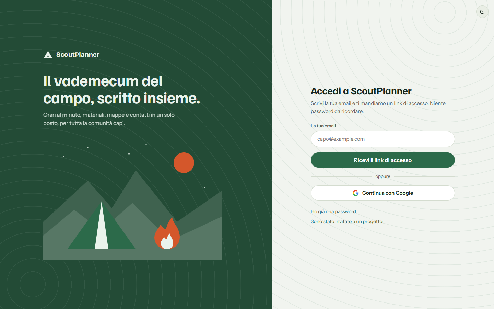
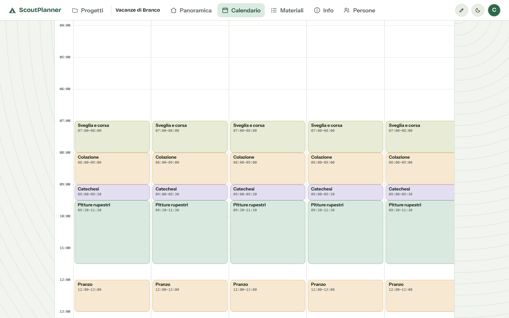
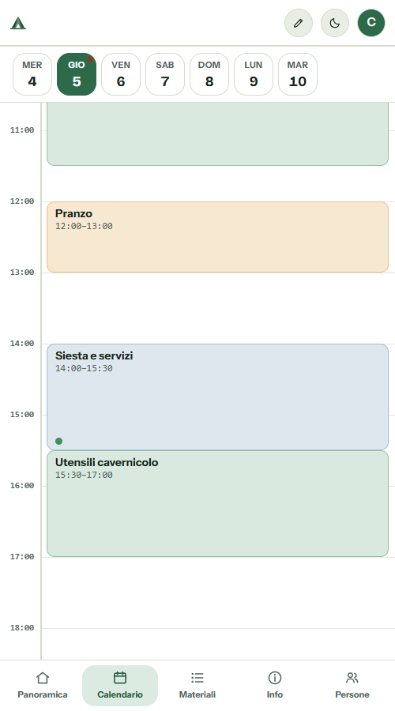
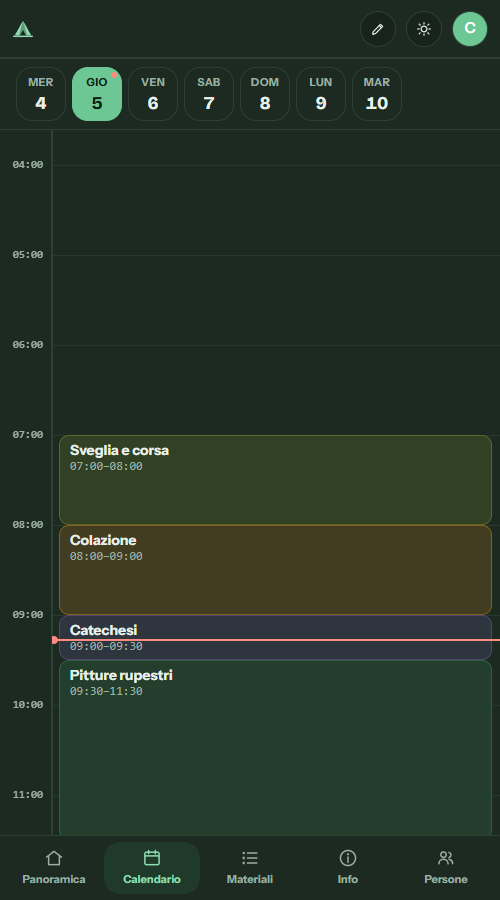

<div align="center">


<br>

[](https://andreadp291-pixel.github.io/ScoutPlanner/)
[](https://github.com/andreadp291-pixel/ScoutPlanner/actions)


**Il vademecum del campo, scritto insieme.**
Orari al minuto, materiali, mappe e contatti in un solo posto, per tutta la comunità capi.

</div>

---

## ✨ Cosa fa

| | |
|---|---|
| 📅 **Calendario** | Attività con orari a precisione di 1 minuto, categorie e colori. Si trascinano, si ridimensionano, si scambiano. |
| 👥 **Gruppi e persone** | Gruppi (squadriglie, branchi…), assegnazione delle attività alle persone del progetto, «solo le mie» e stato *fatta / da fare* per ognuno. |
| 🧰 **Materiali** | Lista unica generata dai materiali delle attività, con chi li procura e chi li trasporta. |
| 🗺️ **Mappe e GPX** | Luogo del campo, punti di interesse (ospedale, farmacia, vigili del fuoco…) e tracce GPX con profilo altimetrico. |
| 📝 **Pagine** | Pagine libere a blocchi: titoli, testo, tabelle, immagini, percorsi e tempi di viaggio. |
| 💬 **Commenti** | Discussioni su attività e pagine, con risposte e «segna come risolto». |
| 🔗 **Condivisione** | Inviti con email, oppure link anonimi con scadenza. Ruoli *editor*, *commentatore* e *sola lettura*, cambiabili in ogni momento. |
| 🙋 **Accessi** | Chi apre un progetto senza permessi può chiedere l'accesso; il proprietario approva scegliendo il ruolo. Il progetto si può cedere a un'altra persona. |
| 🕓 **Cronologia e cestino** | Chi ha cambiato cosa e quando, con ripristino della versione precedente. Le cose eliminate restano nel cestino 30 giorni. |
| 🔔 **Novità in tempo reale** | Campanella con le modifiche degli altri, «chi c'è adesso» nel progetto, dati che si aggiornano da soli e avviso se qualcuno modifica ciò che stai scrivendo, per non sovrascrivere il suo lavoro. |
| ✉️ **Email** | Avvisi quando ti assegnano o cambia un'attività e quando arriva un commento. Prima del campo, promemoria «ti mancano da compilare…» con i link. Ognuno può spegnerli. Durante il campo non parte nessuna email automatica. |
| 🔑 **Accesso** | Link magico via email, password, oppure **Continua con Google**. |
| 📱 **Telefono** | Un giorno per volta a tutta larghezza, barra di schede in basso, finestre che salgono dal basso. Pensato per consultarlo sul campo. |
| 🌙 **Tema scuro** | Chiaro e scuro, con le curve di livello nello sfondo. |

## 🖼️ Com'è fatta

<div align="center">



<br><br>



<br><br>


&nbsp;&nbsp;


</div>

## 🧱 Com'è fatto

```
ScoutPlanner
├── frontend/   React 19 + Vite + TanStack Query + zustand   → GitHub Pages
├── backend/    FastAPI + SQLite                            → un tuo server (systemd)
├── docs/       guide e immagini
└── tools/      strumenti di prova (es. GPX)
```

- **Sessioni:** token firmati (itsdangerous), password con argon2, link di condivisione salvati come hash.
- **Frontend:** `HashRouter`, nessun server da configurare lato Pages.
- **Backend:** database SQLite in un file, nessun servizio esterno obbligatorio. Le email usano un account SMTP a scelta.
- **Tempo reale:** controllo periodico del server (ogni 10-12 secondi), senza connessioni sempre aperte.

## 🚀 Provalo in locale

**Backend**

```bash
cd backend
python -m venv venv && venv/Scripts/activate   # su Linux/Mac: source venv/bin/activate
pip install -r requirements.txt
cp .env.example .env                            # imposta SECRET_KEY (e SMTP se vuoi le email)
uvicorn app.main:app --port 8093
```

**Frontend**

```bash
cd frontend
npm install
npm run dev
```

Per il pulsante «Continua con Google» imposta `VITE_GOOGLE_CLIENT_ID` nel frontend e `GOOGLE_CLIENT_ID` nel backend; senza, il pulsante non compare.

**Test**

```bash
cd backend && pytest
```

## 📦 Deploy

- **Frontend:** a ogni push su `main` che tocca `frontend/` parte il workflow *deploy-frontend* e pubblica su GitHub Pages. L'indirizzo dell'API si imposta in `frontend/.env.production` (`VITE_API_BASE`).
- **Backend:** su un qualsiasi server Linux con systemd, vedi [docs/deployment.md](docs/deployment.md).

---

<div align="center">
<sub>Fatto con 🔥 per i campi scout.</sub>
</div>
